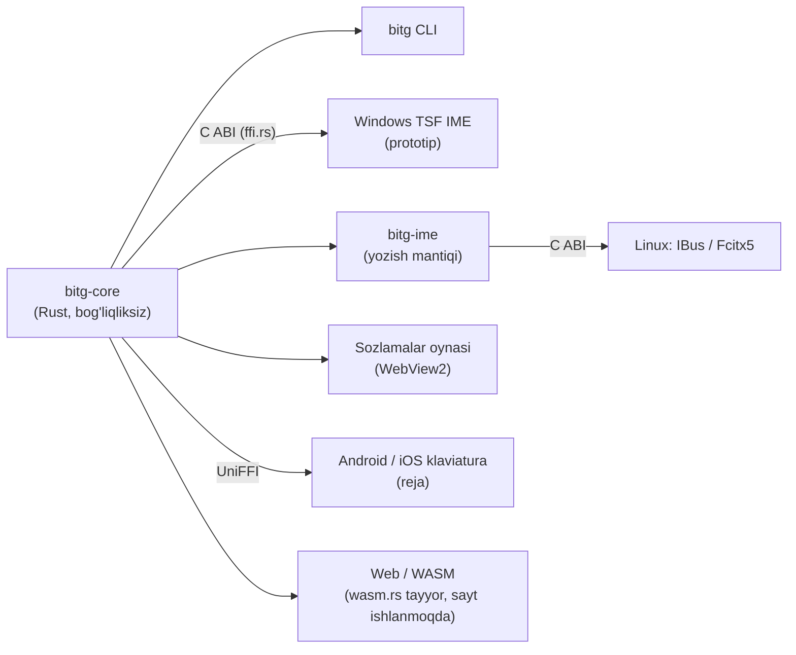

# bitg

[](https://github.com/dtwinuz/bitg/actions/workflows/ci.yml)
[](https://github.com/dtwinuz/bitg/actions/workflows/linux.yml)
[](https://github.com/dtwinuz/bitg/releases/latest)
[](#litsenziya)
[](https://scorecard.dev/viewer/?uri=github.com/dtwinuz/bitg)
[](https://www.bestpractices.dev/projects/16620)
[](https://bitg.uz/yuklab-olish/)

**O'zbek matnini 2026-yilgi lotin alifbosiga o'giradi — yozish paytida, hamma joyda, inglizchani buzmasdan.**
*Uzbek text to the 2026 Latin alphabet (ö ğ ş ç ʼ) — as you type, everywhere, without breaking English.*

> Bitig — qadimgi turkiy tilda «yozuv». [bitg.uz](https://bitg.uz)

O'RQ-1184 qonuni (2026-10-21) to'rtta harfni almashtirdi: **Oʻ → Ö, Gʻ → Ğ, Sh → Ş, Ch → Ç**. Qonun 2027-yil
aprelida kuchga kiradi. bitg — shu o'tishni bir klaviatura bosishiga aylantiradigan ochiq kodli yadro va ilovalar.

<p align="center">
  
</p>

<sub>Haqiqiy yozuv: Release'dagi MSI toza Windows VM'ga o'rnatilgan, tugmalar odam tezligida bosilgan, natija yadro bilan
solishtirilgan ([`tools/demo`](tools/demo), [`demo.yml`](.github/workflows/demo.yml)).</sub>

```text
$ bitg "O'zbekiston shaharlari: Toshkent, Samarqand"
Özbekiston şaharlari: Toşkent, Samarqand

$ bitg "Please check the schedule, keyin choy ichamiz"
Please check the schedule, keyin çoy içamiz

$ bitg old --ascii "Özbekiston şaharlari"
O'zbekiston shaharlari
```

## Nimasi bilan o'zgacha ?

| | |
|---|---|
| 🧠 **Inglizchani tushunadi** | So'z o'zbekcha ekaniga dalil bo'lmasa — tegmaydi. Lug'atlar (o'zbek korpusi + SCOWL), qo'shimchalar bo'yicha o'zak, harf belgilari va gap konteksti: `check`, `How are you shah`, `Obama's`, `Menga chat yozing` o'zgarmaydi; `Menga choy yozing` → `Menga çoy yozing`. |
| 🔒 **Kod va havolalarga tegmaydi** | URL, email, `@user`, `#teg`, domen, `snake_case`, `camelCase`, `push()`, `shahar123` (parolga o'xshash). |
| ✍️ **Tutuq va tirnoqni ajratadi** | 12 xil apostrof bitta deb qaraladi; `'Yaxshi tong'` — tirnoq, `tog'` — ğ; `Is'hoq` → `Ishoq`. |
| 🔁 **Uch yo'nalish** | eski lotin → yangi, kirill → yangi (eng aniq yo'l), yangi → eski (o'tish davri saytlari uchun). |
| ⚡ **Tez va yengil** | 1.4–2.7 µs/so'z, lug'at yuklash 0 ms (qurish vaqtida tayyor jadval), 1.1 MB xotira; tarmoq yo'q, tashqi bog'liqlik yo'q. Bitta yadro: Windows IME, CLI, mobil, web. |
| 📏 **O'lchanadi** | `bitg eval` — real korpusda aniqlik va tezlik. Har o'zgarish raqam bilan tekshiriladi. |

## Sifat (hozirgi holat)

| To'plam | Natija |
|---|---|
| O'zbekcha gaplar (3000 ta, kirill matndan: kirish = eski lotin, kutilgan = yangi lotin, apostrof turlari aralash) | **98.87%** (farqning ko'pi kirill korpus xatosi: maşğul, ğalaba) |
| Apostrofsiz yozilgan o'zbekcha ("ozbek", "togri"; boshqa 3000 gap): butun gap to'g'ri | **81.20%** gap (2436/3000; lug'at kengaytirilgunga qadar 69.07%). Ikki ma'noli so'z (`ochmaydi`, `otdim`) endi jim tiklanmaydi: 3 gap to'g'rilandi, 10 so'z (`otmoqchi`, `oqdan`) yozilganicha qoladi va "tekshiring" deb belgilanadi |
| Inglizcha gaplar (sh/ch/apostrof bor, 3000 ta, Leipzig news + web) — o'zgarmasligi kerak | **99.73%** |
| Tezlik | 2.7 µs/so'z o'zbekcha, 1.4 µs/so'z inglizcha matnda (release, x64) |

O'lchov sanasi: 2026-11-12, `bitg eval eval/{uz,uz_noapos,en}.tsv` (to'plam repoda: [`eval/`](eval/README.md), CC BY 4.0; lug'at qurishda chiqarib tashlangan).

### Tezlik va resurs: raqobatchilar bilan bir xil matnda

Bir xil 3000 gapda (`eval/uz.tsv`, 42 670 so'z; `en.tsv`, 62 082 so'z). Raqobatchilar dvigateli ularning
saytidagi JS bundle'dan olinib, o'zgartirmasdan Node 'da yurgizildi; bitg — `cargo run --release -p bitg-core
--example bench -- eval/uz.tsv`. Isitishdan keyin 5 marta o'rtachasi, bitta mashina.

| | o'zbekcha matn | inglizcha matn | ishga tushish | xotira | inglizcha himoya |
|---|---|---|---|---|---|
| **bitg** (Rust, native) | 2.72 µs/so'z | **1.40** µs/so'z | **0 ms** | **1.1 MB** private | lug'at + kontekst |
| alifbochi.uz (JS) | 2.33 | 1.45 | brauzer sahifasi | Node jarayoni 26–41 MB | yo'q (`shop → şop`) |
| alifbo.akbarovlabs.uz (JS) | 3.39 | 1.93 | brauzer sahifasi | 〃 | yo'q |
| webnum.uz (JS) | 2.27 | 2.06 | brauzer sahifasi | 〃 | faqat imlo belgisi (c, w, ph) |

Xulosa: faqat jadval bilan almashtiradigan konvertorlar o'zbekcha matnda ~15% tezroq, chunki bitg har so'zni
lug'at va kontekst bilan tekshiradi. Inglizcha matnda bitg eng tez. Har qanday holatda bu bir so'zga mikrosekund —
yozayotgan odam sezmaydi (tugmalar orasida ~100 000 µs). Resursda farq katta: lug'at binarga tayyor hash-jadval
bo'lib kiradi (`crates/bitg-core/build.rs`), ishga tushganda tahlil qilinmaydi va xotira ajratilmaydi, IME
yuklangan barcha dasturlar uni bitta nusxada bo'lishadi. Avval har dasturda 15–25 ms (sovuq diskda 0.5 s) va
~8 MB ketardi.

O'zbekcha to'plamda kirish ham, kutilgan javob ham kirill matndan mustaqil olinadi, shuning uchun konvertor
`Is'hoq → Ishoq`, `O'zA → ÖzA`, `Sh.Sharipov → Ş.Şaripov` kabi holatlarni o'zi topishi kerak. Qolgan "xatolarning"
ko'pi korpusdagi shovqin: kirill matndagi imlo xatosi (Киргизистон, Фаргона) — bitg ularni to'g'rilab qo'yadi.

**Apostrof tiklash** (`ozbek → özbek`): nomzod lug'atda asl so'zdan ancha ko'p uchrasa. Asl so'z ham haqiqiy
bo'lsa (`qol/qo'l`, `oz/o'z`, `yoq/yo'q`, `otdi/o'tdi`) — taxmin qilinmaydi; faqat matn muallifi apostrof umuman qo'ymayotgani aniq bo'lsa (o'/g' yo'q va boshqa so'z tiklangan) tiklanadi (`ozbek tilida oz fikrimiz → özbek tilida öz fikrimiz`). Apostrofsiz shakl haqiqiy so'zmi —
faqat kirill korpus aytadi (lotin matnidagi "bolgan" — xato yozuv).

To'plamni o'zingiz qurish: [`tools/build_eval.py`](tools/build_eval.py), so'ng `bitg eval eval/uz.tsv`.

## Tuzilma



| Crate | Vazifa |
|---|---|
| [`bitg-core`](crates/bitg-core) | qoidalar (`latin`), kirill (`cyrillic`), teskari (`reverse`), tokenlar (`token`), til dalili (`lang`), brendlar (`data/names.txt`), yozish sessiyasi (`Session`), C ABI (`ffi`), brauzer ABI (`wasm`, faqat wasm32) |
| [`bitg-cli`](crates/bitg-cli) | `bitg convert / old / explain / eval` |
| [`bitg-settings`](crates/bitg-settings) | sozlamalar oynasi: kalitlar, ro'yxatlar, jonli namuna (Windows, WebView2) |
| [`bitg-ime`](crates/bitg-ime) | platformadan mustaqil yozish mantiqi (Linux): so'z chegarasi, kursor oldidagi matnni tekshirib almashtirish, matn bermaydigan dasturlar uchun preedit, Backspace bilan qaytarish va istisno o'rganish, `settings.ini`/`exceptions.txt` (`~/.config/bitg`); C ABI — [`linux/`](linux) dagi IBus (C) va Fcitx5 (C++) qobiqlari uchun |
| [`bitg-tsf`](crates/bitg-tsf) | Windows matn kiritish xizmati (TSF TIP, Rust): tugmalarga tegmaydi — matn o'zgarishini kuzatadi (`ITfTextEditSink`) va so'zdan keyin probel yozilganda o'sha so'zni joyida almashtiradi. Matnni bermaydigan dasturlarda (Qt: Telegram) — zaxira yo'l: bosilgan harflardan so'z yig'iladi, `SendInput` bilan Backspace + yangi so'z. Hook va clipboard yo'q |

### O'rnatish (Windows 10/11, x64)

[Releases](https://github.com/dtwinuz/bitg/releases) dan `bitg-<versiya>-x64.msi` ni oching. O'rnatuvchi barcha
foydalanuvchilar uchun ishlaydi. Oxirida bitg ochiladi va klaviaturani O'zbek (lotin) tiliga o'zi qo'shadi. So'ng
**Win + Probel** bilan «bitg» ni tanlang. Yangilash ham shu fayl bilan qilinadi: ochiq dasturlarni (Chrome, Telegram)
yopish va kompyuterni qayta yuklash shart emas.

**Paket menejeri bilan** (qisqa nom hamma joyda `bitg`):

```powershell
winget install bitg     # Microsoft katalogida ko'rib chiqilmoqda: microsoft/winget-pkgs#478645
choco install bitg      # Chocolatey: paket tayyor (packaging/chocolatey), e'lon qilinishi kutilmoqda
```

Chocolatey parametrlari: `--params "'/NoAutostart /NoKeyboard'"` (MSI'dagi `AUTOSTART=0`, `ADDKEYBOARD=0`).

| Nima | Qayerda |
|---|---|
| Ilova (tray + sozlamalar), CLI, litsenziyalar | `C:\Program Files\bitg\` (CLI PATH'ga qo'shiladi) |
| IME DLL | `C:\Program Files\bitg\ime\<versiya>\bitg_tsf.dll` — versiyali papka: yangi versiya ochiq dasturlarga xalaqit bermaydi |
| Start menyusi | «bitg» |
| Windows bilan ishga tushish | `HKLM\…\Run` (`--autostart`); har foydalanuvchi ilovadan o'chiradi → `HKCU\Software\bitg\Autostart=0` |
| Foydalanuvchi sozlamalari | `%APPDATA%\bitg` — o'chirishda saqlanib qoladi |

**Korporativ tarqatish** (GPO, Intune, SCCM, PDQ):

```powershell
$msi = (Get-Item .\bitg-*-x64.msi).FullName                      # Release'dan olingan fayl
msiexec /i $msi /qn /l*v bitg-install.log                         # jim o'rnatish
msiexec /i $msi /qn AUTOSTART=0 ADDKEYBOARD=0                     # trayni va klaviaturani avtomatik qo'shmaslik
msiexec /x $msi /qn                                               # o'chirish
```

| Xossa | Standart | Ma'nosi |
|---|---|---|
| `AUTOSTART` | `1` | barcha foydalanuvchilarda tray Windows bilan ishga tushadi |
| `ADDKEYBOARD` | `1` | ilova birinchi ochilganda klaviaturani foydalanuvchining tillar ro'yxatiga qo'shadi (har kimda bir marta; o'chirsa qaytadan qo'shilmaydi) |

Tanlov `HKLM\SOFTWARE\bitg` da saqlanadi, yangilashda eslab qolinadi (buyruq qatoridagi qiymat ustun). Qaytish kodlari
standart: `0` muvaffaqiyat, `3010` qayta yuklash tavsiya etiladi, `1603` xato (sababi `/l*v` logida). DLL ochiq
dasturlarda yuklangan holda **o'chirish** ~1 daqiqa olishi mumkin (Windows Installer band fayllarni tekshiradi). Fayl
baribir o'chadi, qayta yuklash kerak emas.

**«Windows kompyuteringizni himoya qildi» oynasi chiqsa.** Beta MSI hozircha imzolanmagan, shuning uchun
SmartScreen notanish nashriyotchi haqida ogohlantiradi. **Batafsil → Baribir ishga tushirish** ni bosing. Faylni
tekshirish: Release sahifasidagi `.sha256` bilan solishtiring:

```powershell
Get-FileHash .\bitg-*-x64.msi -Algorithm SHA256        # Release'dagi .sha256 bilan bir xil bo'lishi kerak
gh attestation verify .\bitg-*-x64.msi -R dtwinuz/bitg  # GitHub Actions'da shu repodan yig'ilganini isbotlaydi (v0.3.1+)
```

O'rnatuvchini qurish (WiX 5, .NET SDK): `pwsh installer/build.ps1` → `dist/bitg-<versiya>-x64.msi` + `.sha256`.
`-CertThumbprint` yoki `BITG_SIGN_PFX` bilan binarlar va MSI imzolanadi (SHA-256, vaqt tamg'asi). `v*` tegi qo'yilsa,
[`release`](.github/workflows/release.yml) workflow MSI, Linux `.deb` va macOS `.pkg` paketlarini
([`build`](.github/workflows/build.yml) reusable workflow'i yig'adi va imzolaydi, SLSA Build L3) GitHub Release'ga chiqaradi.

### O'rnatish (Linux: Ubuntu 22.04+, Debian 12+, x64)

[Releases](https://github.com/dtwinuz/bitg/releases) dan paketni oling. IBus (Ubuntu, Debian GNOME standarti):

```bash
sudo apt install ./bitg_0.3.1_amd64.deb      # IBus dvigateli + bitg CLI
ibus restart                                  # yoki tizimdan chiqib qayta kiring
```

Yoki o'zi yangilanib turadigan imzolangan apt ombori (kalit izi `9EA5 79E2 9EC7 A7B1 1FC1 B02F BB03 FCBA D1C7 CB35`,
[`deploy/apt/bitg.asc`](deploy/apt/bitg.asc)):

```bash
sudo install -d -m 0755 /etc/apt/keyrings
curl -fsSL https://bitg.uz/apt/bitg.gpg | sudo tee /etc/apt/keyrings/bitg.gpg >/dev/null
echo "deb [arch=amd64 signed-by=/etc/apt/keyrings/bitg.gpg] https://bitg.uz/apt stable main" \
  | sudo tee /etc/apt/sources.list.d/bitg.list
sudo apt update && sudo apt install bitg     # Fcitx5: fcitx5-bitg
```

So'ng **Sozlamalar → Klaviatura → Kiritish manbasi qo'shish → O'zbek → bitg** va **Super + Probel** bilan tanlang.
Fcitx5 ishlatsangiz (KDE va boshqalar), `fcitx5-bitg_0.3.1_amd64.deb` ni o'rnatib, `fcitx5-configtool` da «bitg» ni
qo'shing — bu qo'shimcha hozircha **sinov bosqichida**.

| Nima | Qayerda |
|---|---|
| IBus dvigateli | `/usr/libexec/ibus-engine-bitg`, `/usr/share/ibus/component/bitg.xml` |
| Fcitx5 qo'shimchasi | `/usr/lib/<arch>/fcitx5/bitg.so`, `/usr/share/fcitx5/{addon,inputmethod}/bitg.conf` |
| Sozlamalar | `~/.config/bitg/settings.ini`, `exceptions.txt` — Windows bilan bir xil format, o'zgarish ~1 soniyada qo'llanadi |

Matnni bermaydigan dasturlarda so'z yozilayotganda tagi chizilgan (preedit) ko'rinadi va probelda o'girilib yoziladi.
Parol, PIN, email maydonlari va terminallarda bitg o'chiq turadi. Yig'ish: `linux/build-deb.sh` (`libibus-1.0-dev`,
`libfcitx5core-dev`); sinov: `dbus-run-session -- python3 linux/test/ibus_e2e.py`.

**Arch Linux** (Manjaro, EndeavourOS): [`packaging/aur/PKGBUILD`](packaging/aur) manbadan yig'adi va ikkita paket
beradi: `bitg` (IBus + CLI) va `fcitx5-bitg`. CI har PR'da toza Arch konteynerida yig'ib, o'rnatib, sinab ko'radi.
AUR'da hali yo'q (yangi akkaunt ochish vaqtincha yopiq) — shu PKGBUILD bilan o'zingiz yig'ing:

```bash
git clone --depth 1 https://github.com/dtwinuz/bitg.git && cd bitg/packaging/aur
makepkg --syncdeps                                    # Release tarball'ini oladi, SHA-256 va check() bilan
sudo pacman -U bitg-[0-9]*.pkg.tar.zst                # IBus; Fcitx5 uchun: fcitx5-bitg-[0-9]*.pkg.tar.zst
ibus restart
```

### O'rnatish (macOS 11+, Apple M va Intel) — sinov

Homebrew bilan ([dtwinuz/homebrew-tap](https://github.com/dtwinuz/homebrew-tap)), `brew upgrade` bilan yangilanadi:

```bash
brew install --cask dtwinuz/tap/bitg
```

Yoki qo'lda: [bitg.uz/yuklab-olish](https://bitg.uz/yuklab-olish/#mac) dan `bitg-<versiya>-macos.pkg` ni oling (SHA-256 shu
sahifada va [Releases](https://github.com/dtwinuz/bitg/releases) da): bitta universal fayl
(arm64 + x86_64). O'rnatuvchi hozircha Apple imzosiz — ochilmasa **Tizim sozlamalari → Maxfiylik va xavfsizlik →
Baribir ochish**, yoki terminalda:

```bash
sudo installer -pkg ~/Downloads/bitg-0.3.1-macos.pkg -target /
```

bitg `/Library/Input Methods/bitg.app` ga yoziladi va kiritish manbalariga o'zi qo'shiladi (ko'rinmasa — tizimdan
chiqib qayta kiring). **Control + Probel** bilan tanlang. Terminal, iTerm, Warp, kitty va boshqa terminallarda o'chiq.
Menyu satridagi kiritish manbalari menyusida (bitg tanlanganda): **bitg yoqilgan**, **<dastur> dasturida o'chirish**,
**qaytarilgan so'zlarni eslab qolish**, **istisno so'zlar** — hammasi `settings.ini` ga Windows bilan bir xil kalitlarda
(`enabled`, `disabled_apps` — bundle ID'lar, `undo_remember`) yoziladi va joriy dasturga darhol qo'llanadi.

| Nima | Qayerda |
|---|---|
| Kiritish usuli (InputMethodKit) | `/Library/Input Methods/bitg.app` — [`macos/Sources`](macos/Sources) (Swift) + `bitg-ime` (Rust, C ABI) |
| Sozlamalar | `~/Library/Application Support/bitg/settings.ini`, `exceptions.txt` |

Yig'ish (Xcode Command Line Tools): `macos/build.sh` → `target/macos/bitg-<versiya>-macos.pkg`; sinov (soxta matn
maydoni, IMK'siz): `target/macos/bitg-test`. CI ([`macos`](.github/workflows/macos.yml)) paketni o'rnatib, serverni
ishga tushiradi va kiritish manbasi yoqilishini tekshiradi. Real dasturlarda (Safari, Chrome, Notes, Word, Telegram)
hali sinalmagan — muammo bo'lsa [issue](https://github.com/dtwinuz/bitg/issues) oching.

Ishlab chiqishda (MSI'siz):

```powershell
cargo build --release -p bitg-tsf
regsvr32 target\release\bitg_tsf.dll          # administrator; o'chirish: regsvr32 /u ...
```

Log: `%LOCALAPPDATA%\bitg\tsf.log` — faqat dastur nomi va natija (`converted`, `word unchanged`, xato kodi);
yozilgan matn hech qachon saqlanmaydi.

**bitg ilovasi** — `bitg-settings.exe` ([`crates/bitg-settings`](crates/bitg-settings), WebView2; Start menyusida «bitg»):
tray belgisi (bosish — oyna, o'ng tugma — yoqish/o'chirish, o'chiq holatda kulrang), Windows bilan ishga tushish,
bitta nusxa. Bo'limlar: Asosiy (zarrachalardan yasalgan jonli harf Oʻ→Ö, Sh→Ş; bugungi va 14 kunlik statistika,
klaviatura o'rnatilganini tekshirish), Sinash, Matnni o'girish (eski↔yangi, kirill), Qoidalar, Dasturlar (har dastur
uchun yoqish/o'chirish), Istisnolar, Haqida. Statistika IME log'idan: unda faqat vaqt, dastur nomi va natija bor.
O'zgarishlar darhol saqlanadi; IME ularni bir soniya ichida, dasturlarni qayta ochmasdan qabul qiladi.
Dizayn yo'nalishi: [`crates/bitg-settings/DESIGN.md`](crates/bitg-settings/DESIGN.md).

Fayllar (qo'lda tahrirlash ham mumkin): `%APPDATA%\bitg\settings.ini` (`enabled`, `english_guard`, `cyrillic`,
`restore_apostrophes`, `tutuq`, `undo_backspace`, `undo_remember`, `fallback`, `disabled_apps`, `auto_convert`,
`keymap`, `layout`) va `%APPDATA%\bitg\exceptions.txt` (har qatorda bitta so'z).

| Dastur turi | Holat |
|---|---|
| TSF'ni to'liq qo'llaydigan (WPF, UWP/WinUI, Word, Chrome'ning ko'p maydonlari) | ✅ ishlaydi (CI'da avtomatik e2e: WPF x64/x86, Win32 EDIT x64) |
| Qt / eski IMM32 dasturlari (Telegram Desktop) | ⚠️ zaxira yo'l: bosilgan harflardan so'z yig'iladi, probeldan keyin Backspace + qayta yozish. CI'da Qt (PySide6 QTextEdit) e2e: birinchi so'z, bekor qilish, apostrof, tez yozilgan gap ([`tools/e2e/qt-e2e.py`](tools/e2e/qt-e2e.py)); qo'lda: [`docs/sinov-sozlar.md`](docs/sinov-sozlar.md). Ma'lum muammolar pastda |
| Terminallar (Termius, Windows Terminal, PuTTY...) | ⛔ standart holatda o'chiq (buyruq va parol yoziladi); oynadan yoqish mumkin |

#### Telegram (zaxira yo'l): ma'lum muammolar

| Belgi | Sabab | Holat |
|---|---|---|
| `öozbek`, `şshapaloq`, `qqo'l` — so'z o'girilib, darhol buzilib qaytadi (logda `converted` va shu soniyada `undo`) | bitg o'zi yuborgan Backspace'ni foydalanuvchiniki deb bildi va «bekor qilish»ni ishga tushirdi: Qt `dwExtraInfo` belgisini (RETYPE_TAG) TSF'ga yetkazmaydi | 2026-11-12 tuzatildi: belgiga qo'shimcha sanagich (`State::take_retype`, 1.5 s oyna). Telegram logida o'z-o'zidan `undo` endi yo'q |
| Tez yozganda so'z aralashadi (`shşahar`, `qo'l shaşap`) | probeldan keyingi Backspace + yangi so'z navbat oxiriga tushadi, foydalanuvchi oldindan yozgan harflar esa ulardan oldin turadi — Backspace'lar yangi harflarni o'chiradi | 2026-11-12 tuzatildi: tahrir navbatda turganda bosilgan tugmalar ushlanib, undan keyin qayta yuboriladi (tartib bo'yicha taniladi, `dwExtraInfo` kerak emas). Logda `fallback: keys typed ahead of retype, reordered`. CI'dagi Qt e2e tasdiqlagan; **Telegramda qo'lda tasdiqlanmagan** |
| Birinchi so'z o'girilmaydi / `word not tracked` | sabab endi logda: `fallback: word not tracked: <sabab>` | log kutilmoqda |
| Qotish | har tugma ishlovchisi ≥25 ms bo'lsa `slow test key / key down: N ms` | log kutilmoqda |

Telegramning o'zini avtomatik sinab bo'lmaydi: haqiqiy klaviatura bosishi (SendInput) kerak, ishlab chiquvchi mashinasida
global tugma yuborish taqiqlangan va u faqat CI VM'da (`GITHUB_ACTIONS=true`) ishlaydi. O'rniga CI'da Qt sinov ilovasi
Telegram bilan bir xil yo'ldan (IMM32/CUAS, matn TSF'ga berilmaydi) o'tadi.

`cargo run -p bitg-tsf --example activate` — profilni shu jarayonda yoqib, TSF nimani faol deb bilishini chiqaradi.

## Ishlatish

```sh
cargo install --path crates/bitg-cli
bitg explain "Chat with the team, keyin choy"   # har bir so'z bo'yicha qaror
bitg cyr "O'zbekiston shaharlari"               # lotindan kirillga: Ўзбекистон шаҳарлари
```

### Fayllar va oldindan ko'rish

```sh
bitg file hujjat.docx              # → hujjat.yangi.docx (asl fayl o'zgarmaydi)
bitg file jadval.xlsx -o yangi.xlsx
bitg file eski.txt maqola.md       # matn fayllar (UTF-8)
bitg file hujjat.docx --old        # teskari: → hujjat.eski.docx
bitg file hujjat.docx --dry-run    # yozmasdan: "  12× o'zbek → özbek" va jami
bitg diff < maqola.txt             # matn bo'yicha: "3: shahar → şahar" (qator raqami bilan)
```

`.docx` da asosiy matn, kolontitullar, sahifa osti izohlari (footnote/endnote) va sharhlar o'giriladi; so'z bir nechta run'ga
bo'linib ketgan bo'lsa ham abzats bitta matn sifatida o'giriladi va formatlash (qalin, kursiv, shrift) joyida
qoladi. `.xlsx` da satrlar (shared strings, rich text, inline) o'giriladi — formula va sonlarga tegilmaydi.
Boshqa XML va zip yozuvlari baytma-bayt ko'chiriladi. Kirish fayli ustiga faqat `--in-place` bilan yoziladi.

### Kirill alifbosiga

`bitg cyr` (Rust'da `bitg_core::to_cyrillic`) eski (o' g' sh ch ') va yangi (ö ğ ş ç ʼ) lotinni o'zbek
kirilliga o'giradi; MATN bo'lmasa stdin'dan o'qiydi. Inglizcha so'z, havola, email va kod lotinda qoladi.
e so'z boshida va unlidan keyin э, ya/yo/yu/ye → я/ё/ю/е, tutuq → ъ; ts → ц faqat -tsiya, -tsion, -tsey,
-tsent, -tsept qismlarida (aytsa → айтса). Lotinda yo'qolgan ь, ц (sirk), щ, ы tiklanmaydi.

Rust'dan:

```rust
use bitg_core::{convert, Options, Session};

let text = convert("O'zbekiston shaharlari", &Options::default());

// Yozish paytida (IME): so'z tugaganda
let mut s = Session::new();
if let Some(edit) = s.complete_word("choy", &Options::default()) {
    // edit.delete ta belgini o'chirib, edit.insert ni yozing
}
```

### Klaviatura tartibi (avto o'girishsiz)

Sozlamalar → **Klaviatura**: «Avtomatik o'girish» va «Yangi harflar tugmada» alohida yoqiladi. Ikkinchisi
yoqilsa, bitg klaviaturasi tanlangan oynada tugma darhol yangi harfni yozadi:

| Tartib | Nima o'zgaradi |
|---|---|
| Tilmoch (standart, [tilmoch.ai](https://tilmoch.ai/ru/terilmalar) asosida) | `[` ö, `]` ğ, `;` ş, `'` ç, `` ` `` tutuq ʼ (U+02BC); `\` → `;` `:`; qavslar va `;` `'` — AltGr bilan; `№` — AltGr+Shift+3 |
| [kiritish.uz](https://kiritish.uz/windows/) («Özbekça - yangi», MIT) | Tilmoch bilan deyarli bir xil: `[` ö, `]` ğ, `;` ş, `'` ç, `` ` `` ʼ, `\` → `;` `:`; AltGr+K/L — “ ” ‘ ’, AltGr+`-` — tire |
| [TezYechim](https://tezyechim.uz/en) («Özbek lotin 2026») | `[` ç, `]` ö, `-` ğ, `=` ş; tutuq — o'ng Alt + `'`; `[ ] - =` o'ng Alt bilan |
| Turkcha Q | `[` ğ, `]` ü, `;` ş, `'` i, `,` ö, `.` ç, `i` → ı; vergul `\`, nuqta `/` da |
| Faqat AltGr | hech narsa ko'chmaydi: o'ng Alt + O G S C → ö ğ ş ç |
| Kirill | Windows «O'zbek (kirill)» tartibi (`o` ў, `s` қ, `-` ғ, `=` ҳ); avto o'girish yoqiq bo'lsa kirillcha so'z probeldan keyin yangi lotinga o'tadi, o'chiq bo'lsa kirill qoladi |
| Maxsus | oynada tugmani bosib, 4 qatlamning (oddiy, Shift, AltGr, AltGr+Shift) istalganiga istalgan belgi |

Maxsus tartib `%APPDATA%\bitg\keymap.txt` da (har qator: `tugma oddiy Shift AltGr AltGr+Shift`, `-` — o'zgarmaydi,
`U+XXXX` — belgi kodi) va qo'lda tahrirlansa ham bir soniyada qabul qilinadi. Tartibni IME'ning o'zi bajaradi
(tray ilovasi shart emas, administrator oynalarida ham ishlaydi): tugma TSF'da ushlanadi va belgi tahrir
sessiyasida yoziladi (eski IMM32 dasturlarida qisqa kompozitsiya bilan), AltGr qatlamlari — o'ng Alt uchun
"preserved key". Ctrl/Alt/Win bilan tezkor tugmalar inglizcha joyida, o'chirilgan dasturlarda (terminallar)
tugmalar o'zgarmaydi.

**Backspace bilan bekor qilish:** so'z o'girilgandan keyin darhol Backspace bosilsa, asl so'z qaytadi va shu
dasturda boshqa o'girilmaydi. `exceptions.txt` ga doimiy yozish alohida sozlama — «Qaytarilgan so'zni istisnoga
yozish» (`undo_remember`, standart holatda **o'chiq**). Istisnolar sahifasida qidirish va o'chirish bor.

**Brendlar:** `crates/bitg-core/src/data/names.txt` — sh/ch li savdo belgilari (Photoshop, Chevrolet, Toshiba)
o'zbek qo'shimchasi bilan ham o'girilmaydi. Kishi va joy nomlari ro'yxatda yo'q: ular o'zbek imlosida yoziladi.

### Belgilangan matnni o'girish (Ctrl+Shift+Y)

Istalgan dasturda (bitg klaviaturasi tanlanmagan bo'lsa ham) matnni belgilab **Ctrl+Shift+Y** bosing — u o'sha
joyda yangi alifboga o'tadi. Tugmani tray ilovasi ushlaydi: Ctrl+C bilan matn olinadi, sozlamalaringiz
(istisnolar, inglizcha so'zlar, tutuq) bilan o'giriladi va Ctrl+V bilan joylanadi; clipboard'dagi avvalgi
narsa keyin joyiga qaytariladi. Hech narsa belgilanmagan bo'lsa yoki matn o'zgarmasa — hech narsa qilinmaydi.
Terminallarda (Dasturlar ro'yxati) ishlamaydi, chunki u yerda Ctrl+C jarayonni to'xtatadi.

Sozlamalar → **Qoidalar → Belgilangan matn**: yoqish/o'chirish va tugmalar (Ctrl+Shift+Y, Ctrl+Shift+B,
Ctrl+Shift+F8). `settings.ini` da: `hotkey=1`, `hotkey_keys=ctrl+shift+y` (Ctrl, Alt yoki Win bilan istalgan
harf, raqam yoki F1–F24), `hotkey_old_keys=` — teskari yo'nalish (yangi → eski lotin), standart holatda
o'chiq. Tugma boshqa dasturda band bo'lsa, oynada shu haqda yoziladi.

## Lug'at

`crates/bitg-core/src/data/*.tsv` — faqat so'z va og'irlik (matnlarning o'zi emas). Binarga qurish vaqtida
tayyor hash-jadval bo'lib kiradi (`crates/bitg-core/build.rs`).

| Fayl | Nima | Manba va litsenziya |
|---|---|---|
| `uz.tsv` (71 933 so'z) | o'zbekcha so'z (eski lotin kaliti) → og'irlik `log10(chastota)+1`; `0` = o'/g' siz shakl kirillda uchramaydi (`boladi`: faqat `bo'ladi`) | [Leipzig Corpora Collection](https://wortschatz.uni-leipzig.de/en/download/Uzbek) (CC BY 4.0): `uzb_community_2017` (faqat kirill gaplar), `uzb_wikipedia_2014/2016/2021_100K`, `uzb_news_2020_10K`, `uzb_newscrawl_2011_100K`; [Mozilla Common Voice](https://github.com/common-voice/common-voice/tree/main/server/data/uz) `sentence-collector.txt` (CC0); [Tatoeba](https://tatoeba.org) `uzb_sentences.tsv` (CC BY 2.0 FR) |
| `sh_split.tsv` | kirillda s+h alohida so'zlar (Исҳоқ, нусҳа, Мусҳаф): `sh` → ş bo'lmaydi | yuqoridagi kirill gaplar |
| `en.tsv` | inglizcha so'z → SCOWL darajasi | [SCOWL 2020.12.07](http://wordlist.aspell.net/) (Kevin Atkinson, ruxsat beruvchi litsenziya) |
| `names.txt` | brendlar (qo'lda) | — |
| `foreign_names.txt` (1 394 nom) | faqat xorijiy imloda uchraydigan kishi/joy nomlari (ch/sh bor, `uz.tsv` da yo'q): `Michelle`, `Rachel`, `Sanchez` | SCOWL `*-proper-names` (daraja ≤ 80), `tools/build_foreign_names.py` |

**Nomlar.** O'zbek imlosida ham shunday yoziladigan nom (Ричард → `Richard`, `Pushkin`, `Shohruh`) o'giriladi:
`Riçard`, `Puşkin`. Xorijiy imlodagi nom (o'zbek korpusida yo'q, inglizcha nomlar ro'yxatida bor yoki o'zbek
lotinida bo'lmaydigan belgi bor: yolg'iz `c`, `w`, `th`, `-lle`) o'girilmaydi — `Miçelle` hech bir imloda to'g'ri
emas. Yonma-yon nomlar (bog'lovchi `va`/`and` orqali ham) bitta zanjir: zanjirda xorijiy nom bo'lsa, ikki xil
o'qiladigan qo'shnisi ham asl yozuvida qoladi (`Charlie Chaplin`, `Richard va Michelle`). Vergul zanjirni uzadi;
xorijiy nom gap tilini belgilamaydi (`Chicagoda yaşaydi`). Yozish paytida (IME) faqat chap qo'shni ma'lum:
`Charlie Chaplin` ushlanadi, `Richard va Michelle` dagi `Richard` esa `Michelle` yozilishidan oldin o'giriladi.

**Ikki ma'noli so'zlar.** Apostrofsiz so'z ikki haqiqiy o'zakdan yasalgan bo'lsa (`och|maydi` / `o'ch|maydi`,
`ot|dim` / `o't|dim`), apostrofsiz shakli korpusda uchramasa va apostrofli nomzod ham siyrak bo'lsa (og'irlik < 3.0),
chastota hech narsa demaydi — so'z yozilganicha qoladi. Nomzod keng tarqalgan bo'lsa (`oqish` → `o'qish`,
`boyicha` → `bo'yicha`) shaklning yo'qligining o'zi dalil va tiklanadi. Matnda o'/g' apostrofi umuman bo'lmasa,
bunday so'zlarning ikkinchi o'qilishi `convert_words` (`Word::alt`), `bitg explain` va saytdagi konvertorda
ko'rsatiladi: so'z sariq belgilanadi, bosilsa boshqa o'qilishiga almashadi.

Faqat CC0 / CC BY / ruxsat beruvchi manbalar. O'zbek Vikipediyasi dumpi (CC BY-SA) ataylab ishlatilmaydi:
ShareAlike sharti MIT / Apache-2.0 binarga mos emas. Leipzig'ning yuklab olinadigan korpuslari CC BY 4.0
([Terms of Usage](https://wortschatz.uni-leipzig.de/en/usage)).

**O'qitish/test ajratilgan:** [`eval/`](eval/README.md) dagi baholash gaplari lug'atga kirmaydi
(`--exclude-eval`). Avvalgi lug'at `uzb_community_2017-words.txt` sanog'idan qurilgan edi — unda eval gaplari ham
sanalgan, shuning uchun eski 99.17% / 69.07% biroz oshirilgan edi. Eval chiqarib tashlangan holda eski manbalar
bilan: 98.87% / 68.50% / 99.73%.

| Lug'at | uz | uz apostrofsiz | en | uz.tsv | bitg.exe |
|---|---|---|---|---|---|
| avvalgi (eval gaplari sanoqda bor edi) | 99.17% | 69.07% | 99.73% | 45 614 so'z, 736 KB | 2.78 MB |
| avvalgi manbalar, eval chiqarilgan | 98.87% | 68.50% | 99.73% | 45 021 so'z | — |
| 0.2.0 | 98.87% | 81.30% | 99.73% | 71 933 so'z, 1.1 MB | 3.73 MB |
| **hozirgi** (ikki ma'noli so'z tiklanmaydi, xorijiy nomlar) | **98.87%** | **81.20%** | **99.73%** | 71 933 so'z, 1.1 MB | — |

Apostrofsiz matndagi o'sish manbalari: kengroq lug'at; kirillda uchramaydigan apostrofsiz shakl `0` og'irlik
bilan yoziladi (aks holda `boladi` o'zak orqali `bola|di` deb hisoblanib, `bo'ladi` tiklanmasdi); chiziqchali so'z
bo'lak-bo'lak (`qollab-quvvatlash`); matnda o'/g' umuman yo'q va boshqa so'z tiklangan bo'lsa ikki ma'noli so'zlar
ham (`oz → o'z`, `yoq → yo'q`). Tezlik va xotira o'zgarmadi (2.7 / 1.3 µs/so'z, 0.5 MB private); apostrofsiz
matnda 2.5 → 3.3 µs/so'z.

Qayta qurish (manbalarni yuklab, bir papkaga oching):

```
python -I tools/build_lexicon.py --scowl scowl-2020.12.07   --sentences-cyrillic-only uzb_community_2017/uzb_community_2017-sentences.txt   --sentences uzb_wikipedia_2021_100K/uzb_wikipedia_2021_100K-sentences.txt       uzb_wikipedia_2016_100K/uzb_wikipedia_2016_100K-sentences.txt       uzb_wikipedia_2014_100K/uzb_wikipedia_2014_100K-sentences.txt       uzb_news_2020_10K/uzb_news_2020_10K-sentences.txt       uzb_newscrawl_2011_100K/uzb_newscrawl_2011_100K-sentences.txt       sentence-collector.txt uzb_sentences.tsv   --exclude-eval eval/uz.tsv eval/uz_noapos.tsv
```

Standart sozlamalar: `--min-freq 3 --context-top 40000 --bare-rare-min 100`. So'ng `cargo build --release -p
bitg-cli` va `bitg eval eval/uz.tsv` (shuningdek `uz_noapos.tsv`, `en.tsv`).

## Yo'l xaritasi

To'liq reja: [ROADMAP.md](ROADMAP.md). Qisqasi:

- [x] Yadro, CLI, inglizcha himoya, o'lchov; Windows TSF IME + sozlamalar + MSI (v0.1.0)
- [x] **Linux (Ubuntu)** — IBus dvigateli va `.deb` paket, haqiqiy `ibus-daemon` bilan CI sinovi (v0.2.0)
- [x] **macOS** — InputMethodKit kiritish usuli, universal `.pkg`, CI'da o'rnatish sinovi (sinov bosqichi, v0.3.0)
- [x] Sayt: [bitg.uz](https://bitg.uz) (`web/`), sinov maydoni haqiqiy yadroda (Rust → WASM)
- [ ] Imzolangan Windows o'rnatuvchi va Microsoft Store; Fcitx5 va macOS real dasturlarda; Fedora `.rpm`, Flatpak
- [ ] v1 — qonun kuchga kirishidan oldin (2027-aprel)
- [ ] **iOS**, Android; Word/brauzer kengaytmasi; B2B API

Loyiha qanday boshqariladi: [GOVERNANCE.md](GOVERNANCE.md) · tuzilma: [ARCHITECTURE.md](ARCHITECTURE.md) ·
xavfsizlik asoslamasi: [docs/ASSURANCE.md](docs/ASSURANCE.md).

## Telefonda (Android, iOS)

Telefonda bitg **Tilmoch** klaviaturasini tavsiya qiladi. Ilova bepul, klaviaturasi eski lotin, kirill va yangi
lotinni biladi. Yangi alifbo rejimida ö, ğ, ş, ç avtomatik qo'yiladi (sozlamada yoqiladi), takliflar internetsiz
ishlaydi. Ichida turkiy tillar uchun tarjimon va ovozli kiritish ham bor —
[App Store](https://apps.apple.com/uz/app/tilmoch/id6739621237) ·
[Google Play](https://play.google.com/store/apps/details?id=com.tahrirchi.tilmoch) ·
[tilmoch.ai](https://tilmoch.ai/ru/product/mobile). O'rnatish qadamlari:
[bitg.uz/yangi-harflarni-yozish](https://bitg.uz/yangi-harflarni-yozish/#telefon). Tilmoch'ning kompyuter klaviatura
tartibi (Windows, macOS) bitg'da `tilmoch` tartibi sifatida bor.

## Hissa qo'shish

Xato, noto'g'ri o'girilgan so'z yoki taklif — [issue](https://github.com/dtwinuz/bitg/issues/new/choose). Savol va
g'oyalar — [Discussions](https://github.com/dtwinuz/bitg/discussions). Kod bilan
yordam: [CONTRIBUTING.md](CONTRIBUTING.md). Zaiflik haqida yopiq xabar: [SECURITY.md](SECURITY.md). O'zgarishlar
tarixi: [CHANGELOG.md](CHANGELOG.md).

## Litsenziya

MIT yoki Apache-2.0 — tanlovingiz bo'yicha.
